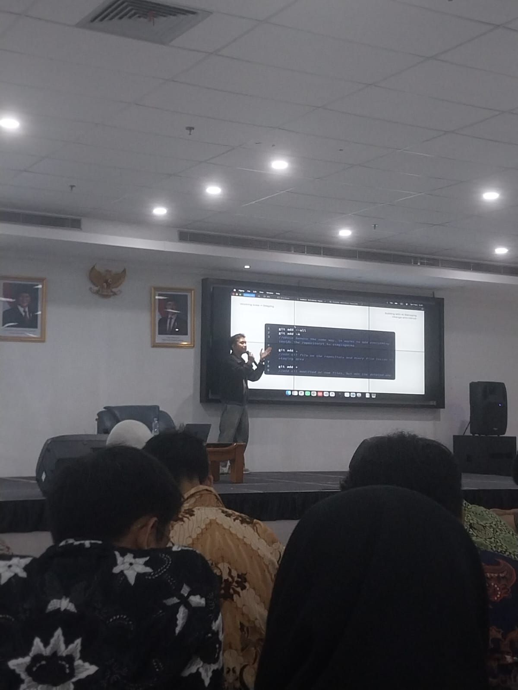

Arya-Bima-Abdillah

Repository adalah  untuk menaruh, mengelola, serta mengatur berbagai berkas, data, atau kode sumber agar mudah diakses, dicari, dan digunakan kembali.

Tujuannya adalah adalah sebagai tempat penyimpanan digital terpusat yang digunakan oleh para developer untuk mengelola kode pemrograman, melacak riwayat perubahan proyek, serta berkolaborasi dengan tim secara efisien.

Workshop ini membahas tentang penggunaan AI dan GitHub dalam membantu proses pembuatan serta pengembangan proyek digital. Materi disampaikan oleh Nugi Farhan, seorang Senior Product Designer. Dalam kegiatan ini, peserta mempelajari cara membuat prompt AI yang baik, mengenal fungsi Git dan GitHub, serta memahami cara menyimpan dan mengelola perubahan pada file atau proyek. Selain itu, dijelaskan juga penggunaan repository, commit, branch, dan pull request untuk mempermudah kerja sama dalam sebuah proyek.

Dokumentasi:

Workshop membahas penggunaan AI untuk membantu membuat website atau aplikasi, serta pengenalan git dan github untuk mengelola perubahan proyek.

Materi mencakup repository, commit, branch, dan pull request. Beberapa perintah git yang dikenalkan antara lain git init, git add, git commit, git push, dan git pull.

Saya jadi memahami perbedaan git dan github. Git digunakan untuk mencatat perubahan proyek, sedangkan github menjadi tempat menyimpan repository secara online dan bekerja sama dengan orang lain. Saya juga belajar bahwa AI dapat membantu proses pembuatan website atau aplikasi melalui prompt yang jelas.

Materinya cukup bermanfaat, tetapi penyampaian seminar terlalu panjang dan kurang langsung ke inti pembahasan. Pengaturan waktu juga kurang teratur. Selain itu, waktu pengumpulan tugas gultik berdekatan dengan tugas perkuliahan sehingga cukup menyulitkan dalam membagi waktu.
Ke depannya, penyampaian materi sebaiknya lebih terarah dan jadwal kegiatan serta tenggat tugas dibuat lebih teratur, sehingga tidak membuat audiens serta panitia mengalami konflik dalam menjalani kerjasama.
